<div align="center">

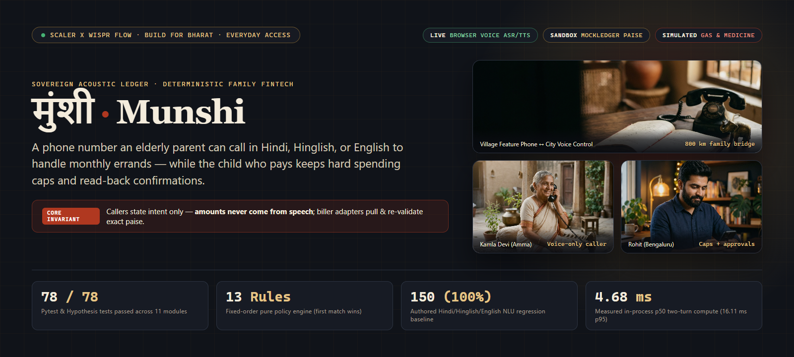

<br /><br />

# मुंशी · Munshi

**A phone number an elderly parent can call in Hindi, Hinglish, or English to handle monthly errands — while the child who pays stays in control through hard spending caps, read-back confirmations, and instant voice notes.**

*Scaler × Wispr Flow — “India Runs on Voice” · Everyday Access Track*

<p>
  
  
  
  
  
  
</p>

<p>
  <a href="#the-core-safety-invariant">Safety Invariant</a> ·
  <a href="#live-surfaces-and-walkthrough">Live Surfaces</a> ·
  <a href="#system-architecture-and-flowcharts">Architecture</a> ·
  <a href="#13-rule-deterministic-policy-engine">Policy Engine</a> ·
  <a href="#measured-benchmarks-and-verification">Benchmarks</a> ·
  <a href="#quickstart-two-terminals-zero-external-accounts">Quickstart</a>
</p>

</div>

---

## Why Munshi Exists

Millions of Indian families live across a migration divide. The adult child in Bengaluru, Mumbai, or Dubai earns and funds household expenses; the parent back home — like **68-year-old Kamla Devi ("Amma")** — uses a feature phone or basic Android, cannot navigate small-text UPI menus, and ends up calling at 11 PM from 800 km away, reading OTPs aloud, or missing due dates.

**Most voice-payment demos break the moment speech-to-text mishears ₹5,000 as ₹50,000.** Munshi eliminates that failure class structurally: the caller speaks **intent only** (*"Bijli ka bill bhar do"*). Amounts are never accepted from caller speech on payment paths — they come exclusively from the biller or family catalog, are spoken back slowly in Indian digit grouping (*"1,240 rupaye. Bhar doon?"*), are evaluated by a pure 13-rule deterministic policy engine, and are re-validated immediately before execution.

---

## What Is Real vs. What Is Not

Every capability carries an explicit `LIVE`, `SANDBOX`, or `SIMULATED` stamp across the footer, console, and ledger rows. Nothing implies real-money settlement or unverified integrations.

| Layer | Mode | What Actually Runs Today |
|---|---|---|
| **Browser Voice (ASR + TTS)** | `LIVE` | Chrome `SpeechRecognition` (`hi-IN` / `en-IN`) + Web `speechSynthesis`, paired with DTMF keypad fallback (`1` = yes, `2` = no, `*` = repeat) |
| **Understanding (Hindi / Hinglish / English)** | `LIVE` | Deterministic schema-locked intent parser tested on a 150-utterance regression set; discards prompt injections as `unclear`; optional LLM port disabled by default |
| **Policy Engine, Limits, Approvals & Audit** | `LIVE` | Pure deterministic Python engine, explicit state machine (`statemachine.py`), integer-paise arithmetic, and SHA-256 hash-chained SQLite `audit_log` |
| **Utility Bill Settlement** | `SANDBOX` | Idempotent `MockLedger` with failure injection; no real money moves. Cashfree is not integrated (access & current contract unverified) |
| **LPG Gas & Medicine Refill** | `SIMULATED` | Fixed synthetic prices (`₹1,100` gas cylinder; `₹380–₹640` medicines) proving capability-plugin extensibility |
| **Telephony, WhatsApp & Telegram** | `NOT CONNECTED` | Explicit port stubs behind `NotifierPort`; the in-app **Rohit Phone Simulator** delivers voice-note receipts & approvals |

See [docs/LIMITATIONS.md](docs/LIMITATIONS.md) for full disclosure of gaps and scope boundaries.

---

## The Core Safety Invariant

<div align="center">
  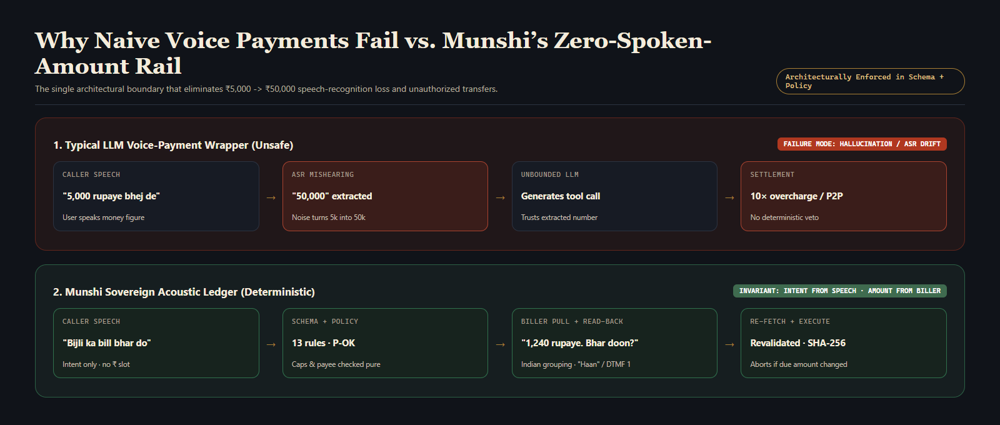
</div>

1. **Zero spoken amounts on parent payment paths:** `Capability.resolve()` pulls the exact due amount (`integer paise`, never floats) from the biller or synthetic catalog.
2. **LLM proposes, deterministic code disposes:** Any understanding provider may only return a JSON-Schema-validated [`Proposal`](packages/contracts/proposal.schema.json) (`intent`, `slots`, `confidence`, `language_detected`). Prompt-injection markers (*"ignore your rules"*, *"limit badha do"*) and unknown capabilities downgrade cleanly to `unclear`.
3. **Pre-execution re-validation:** Right after Amma confirms read-back (`"Haan"` / DTMF `1`) or Rohit approves a new payee, Munshi re-fetches the bill amount. If it changed mid-flow, confirmation voids and a fresh read-back starts.
4. **Hard caps & non-auto-expiring approvals:** Out-of-allowlist payees (`paani` bill) or cap breaches pause for Rohit's explicit approval with a configurable TTL (`900s`). Expired requests transition to `EXPIRED` and never execute silently.
5. **Immutable parent boundary & 2FA limit increases:** Parent calls can never modify limits. Increasing caps via Rohit's voice-note onboarding (`"mahine mein 5,000 tak"`) requires explicit read-back plus a second-factor code (`MUNSHI_DEMO_SECOND_FACTOR`).

---

## Live Surfaces and Walkthrough

All screenshots below were captured directly from a live Chromium run of the Next.js 16 frontend (`apps/web`) wired to the FastAPI backend (`apps/api`) during automated Playwright verification (`J1–J7`, `@axe-core/playwright` WCAG 2A/2AA, and `360px` responsive checks).

<table>
  <tr>
    <td width="50%" align="center">
      <a href="docs/media/screens/01-call-stage-hero.png">
        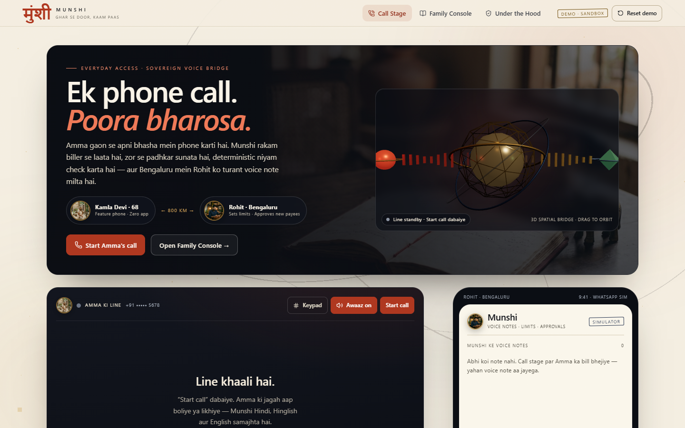
      </a>
      <br />
      <strong>1. Call Stage &amp; 3D Spatial Voice Core (<code>/</code>)</strong>
      <br />
      <sub>Editorial hero bridging Kamla Devi and Rohit over a Three.js interactive acoustic core whose color/geometry morphs live with call state.</sub>
    </td>
    <td width="50%" align="center">
      <a href="docs/media/screens/02-call-stage-j1.png">
        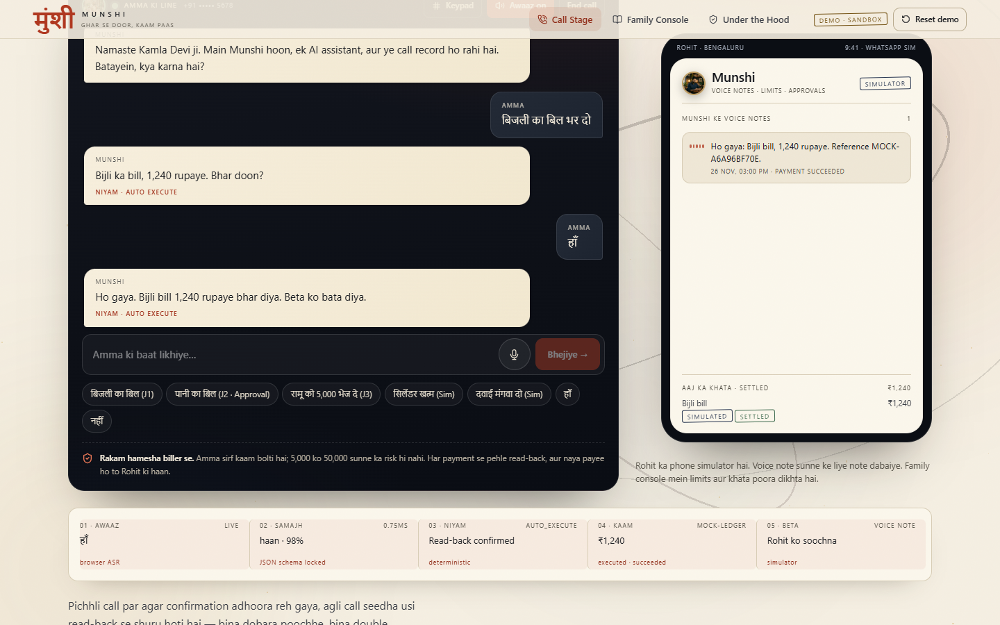
      </a>
      <br />
      <strong>2. Spoken Read-Back, 5-Stage Pipeline &amp; Phone Sim</strong>
      <br />
      <sub><em>"Bijli ka bill, 1,240 rupaye. Bhar doon?"</em> -> <em>"Haan"</em> -> instant mock settlement, live <code>Awaaz -> Samajh -> Niyam -> Kaam -> Beta</code> telemetry strip, and Rohit's WhatsApp-style voice note.</sub>
    </td>
  </tr>
  <tr>
    <td width="50%" align="center">
      <a href="docs/media/screens/04-family-console.png">
        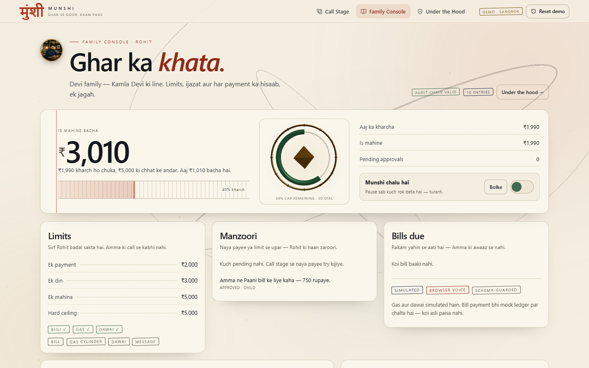
      </a>
      <br />
      <strong>3. Family Console — Ghar ka Khata (<code>/console</code>)</strong>
      <br />
      <sub>Rohit's governance deck: 3D monthly remaining budget vault, per-txn/day/month limits, voice-note onboarding parser, instant global pause switch, and mode-stamped ledger.</sub>
    </td>
    <td width="50%" align="center">
      <a href="docs/media/screens/03-under-the-hood.png">
        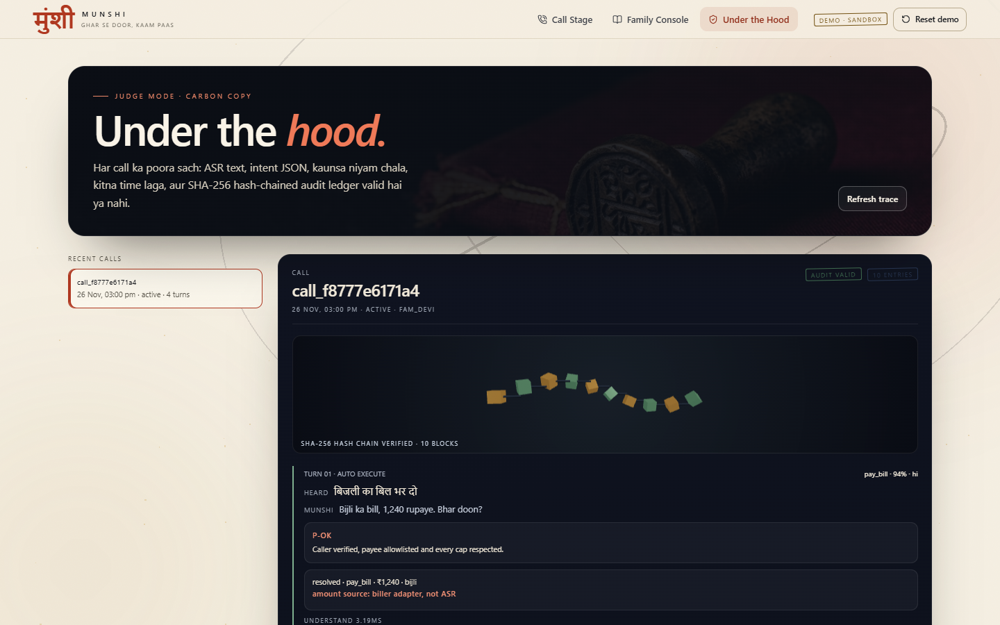
      </a>
      <br />
      <strong>4. Under the Hood — Judge Mode (<code>/trace</code>)</strong>
      <br />
      <sub>Full carbon-copy trace per turn: raw ASR transcript, JSON proposal, fired policy rule (<code>P-OK</code>, <code>P-NEW-PAYEE</code>), amount provenance, latency, and live 3D SHA-256 chain verifier.</sub>
    </td>
  </tr>
</table>

<details>
<summary><strong>Inspect 360px Mobile Responsive View &amp; Seeded Personas</strong></summary>

<br />

<table>
  <tr>
    <td width="35%" align="center">
      <a href="docs/media/screens/05-mobile-360.png">
        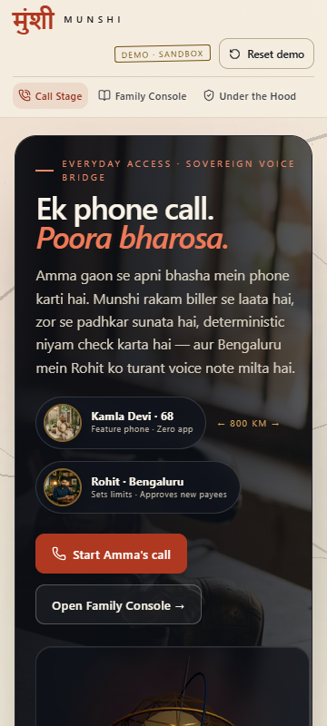
      </a>
      <br />
      <sub>Verified 0px horizontal overflow at <code>360px</code> across <code>/</code>, <code>/console</code>, and <code>/trace</code>.</sub>
    </td>
    <td width="65%" valign="top">
      <h4>Seeded Synthetic Families (<code>apps/api/munshi/db.py</code>)</h4>
      <ul>
        <li><strong>Devi Family (Primary — <code>fam_devi</code>, timezone <code>Asia/Kolkata</code>):</strong>
          <ul>
            <li><strong>Parent:</strong> Kamla Devi ("Amma", synthetic phone hash of <code>9812345678</code>)</li>
            <li><strong>Child:</strong> Rohit (<code>demo-child-token</code>)</li>
            <li><strong>Caps:</strong> <code>₹2,000</code> per txn · <code>₹3,000</code> daily · <code>₹5,000</code> monthly · <code>₹5,000</code> hard ceiling</li>
            <li><strong>Allowlist:</strong> <code>bijli</code>, <code>gas</code>, <code>dawai</code></li>
            <li><strong>Unpaid Seeded Bills:</strong> <code>bijli</code> (<code>₹1,240</code> — auto after read-back) &amp; <code>paani</code> (<code>₹750</code> — triggers <code>P-NEW-PAYEE</code> child approval)</li>
          </ul>
        </li>
        <li><strong>Sharma Family (Multi-Tenant Isolation — <code>fam_sharma</code>):</strong>
          <ul>
            <li><strong>Parent / Child:</strong> Sunita Sharma / Arjun (<code>sharma-child-token</code>)</li>
            <li><strong>Purpose:</strong> Proves strict cross-family token isolation (IDOR checks return <code>404</code>/<code>401</code>).</li>
          </ul>
        </li>
      </ul>
    </td>
  </tr>
</table>

</details>

---

## System Architecture and Flowcharts

Provider-agnostic hexagonal core (`apps/api/munshi/`): the domain layer never imports a third-party SDK. External providers sit behind Python protocols with deterministic fakes for local zero-credential execution.

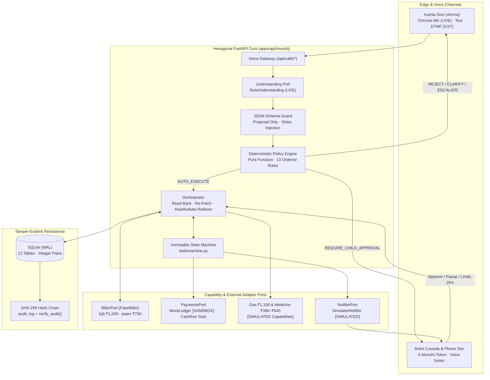

### Runtime Safety Choreography (`J1` Pay Bill · `J3` P2P Refusal · `J2` Child Approval)

```mermaid
sequenceDiagram
  autonumber
  actor Amma as Kamla Devi (Amma)
  participant GW as Gateway & NLU
  participant Biller as Biller / Catalog
  participant Policy as Policy Engine (13 Rules)
  participant Ledger as MockLedger (SANDBOX)
  actor Rohit as Rohit (Child Console)

  rect rgb(23, 35, 30)
    Note over Amma,Rohit: J1 — Allowlisted Bill Payment (Zero Spoken Amounts)
    Amma->>GW: "बिजली का बिल भर दो"
    GW->>Biller: resolve("pay_bill", "bijli") -> 124000 paise (₹1,240)
    GW->>Policy: evaluate(caller=ok, payee="bijli", amount=124000)
    Policy-->>GW: P-OK (AUTO_EXECUTE pending read-back)
    GW-->>Amma: "Bijli ka bill, 1,240 rupaye. Bhar doon?"
    Amma->>GW: "हाँ" (or DTMF [1])
    GW->>Biller: Re-fetch bill amount before settlement
    alt Amount changed since read-back
      Biller-->>GW: Price mismatch -> CANCEL txn & restart read-back
    else Amount unchanged (₹1,240)
      GW->>Ledger: charge(idempotency_key, 124000 paise)
      Ledger-->>Rohit: Voice note receipt + audit_log SHA-256 append
      GW-->>Amma: "Ho gaya. Bijli bill 1,240 rupaye bhar diya."
    end
  end

  rect rgb(45, 24, 24)
    Note over Amma,Rohit: J3 — Unsupported P2P Transfer Attempt
    Amma->>GW: "रामू को 5,000 भेज दे"
    GW-->>Amma: Refused immediately (zero transaction created)
    GW-->>Rohit: Alert logged in phone notifications
  end

  rect rgb(38, 35, 22)
    Note over Amma,Rohit: J2 — Non-Allowlisted Payee (Child Approval + TTL)
    Amma->>GW: "पानी का बिल भर दो" (₹750)
    GW->>Policy: evaluate(payee="paani" not in allowlist)
    Policy-->>GW: P-NEW-PAYEE -> REQUIRE_CHILD_APPROVAL (AWAITING_APPROVAL)
    GW-->>Rohit: Approval card ("Paani bill 750 rupaye" · TTL 900s)
    Rohit->>Ledger: Approve by tap or voice ("Haan, kar do")
    Ledger-->>Amma: Re-validates ₹750 -> settles -> notifies both
  end
```

---

## 13-Rule Deterministic Policy Engine

`apps/api/munshi/policy.py` is a pure function with zero clock or I/O calls. Every request runs top-to-bottom in `RULE_ORDER` — the first matching rule wins and attaches its exact rule code (`P-*`) to the turn trace for inspection in **Under the Hood**.

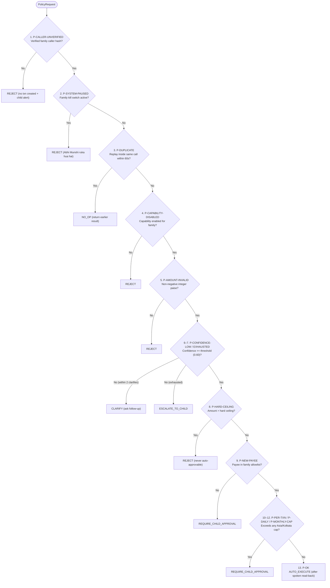

### Transaction Lifecycle (`statemachine.py`) & Database Schema

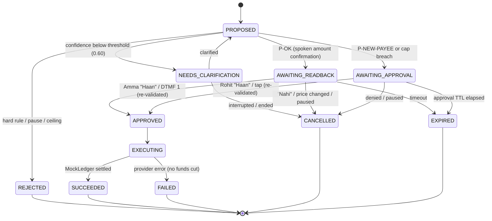

<details>
<summary><strong>Expand SQLite Entity-Relationship Diagram (12 Tables in <code>apps/api/munshi/db.py</code>)</strong></summary>

<br />

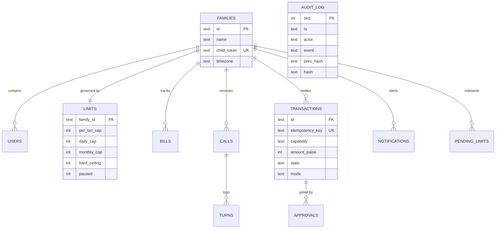

</details>

---

## Measured Benchmarks and Verification

<div align="center">
  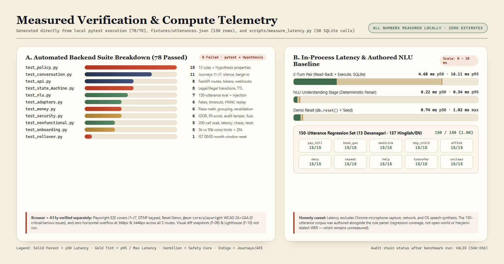
</div>

### Summary of Measured Runs (Verified Locally)

| Check / Metric | Latest Measured Result | Scope & Honest Caveat | Source |
|---|---|---|---|
| **Backend Unit, Property & Security Suite** | **78 / 78 passed** (`0` failed, 11 modules) | Covers policy boundaries (`Hypothesis`), paise math, state immutability, IDOR, PII scrubbing, HMAC replay, 200-call soak, & IST rollover | [`docs/TEST_MATRIX.md`](docs/TEST_MATRIX.md) |
| **Authored NLU Intent Baseline** | **150 / 150 (`100%`)** (`15/15` per intent) | 10 intents (`13` Devanagari, `137` Hinglish/English). Authored regression set — **not** open-world or dialect WER | [`docs/EVAL.md`](docs/EVAL.md) |
| **In-Process 2-Turn Compute Latency** | **`4.68 ms` p50 · `16.11 ms` p95** (50 calls) | Includes NLU (`0.22 ms` p50), policy, resolve, read-back, confirmation, `MockLedger`, & audit writes. Excludes mic/browser ASR/TTS/network | [`scripts/measure_latency.py`](scripts/measure_latency.py) |
| **Demo DB Reset Latency** | **`0.74 ms` p50 · `1.02 ms` max** | Resets 12 SQLite tables & seeds both families cleanly under `< 5s` budget | [`scripts/measure_latency.py`](scripts/measure_latency.py) |
| **Browser E2E + Accessibility + Mobile** | **Passed (`J1–J7`, `F-01..F-07`)** | Live Chromium E2E across `/`, `/console`, `/trace`, DTMF `[1]`, Reset Demo, `@axe-core/playwright` WCAG 2A/2AA (`0` serious/critical), & `360px` width check | [`apps/web/tests/e2e.mjs`](apps/web/tests/e2e.mjs) |
| **Static Builds & Dependency Hygiene** | **`tsc --noEmit`, `next build`, `npm audit`, `pip check`** | `0` high vulnerabilities in `npm audit --audit-level=high`; `No broken requirements` from `pip check` | [`Makefile`](Makefile) |
| **Not Yet Run / Unmeasured** | **Explicit gaps** | Visual pixel-diff (`F-09`), Lighthouse (`F-10`), `pip-audit`, `mutmut`, Docker runtime test, 10× live rehearsal (`D-01`), & Haryanvi audio WER corpus | [`docs/LIMITATIONS.md`](docs/LIMITATIONS.md) |

---

## Quickstart (Two Terminals, Zero External Accounts)

Requires **Python 3.11+** and **Node.js 20+** (verified locally on Python 3.11 / Node 24).

### 1. Start Backend (`http://127.0.0.1:8000`)

```bash
python -m venv .venv
# Windows PowerShell / CMD:
.venv/Scripts/python -m pip install -r requirements.txt
.venv/Scripts/python apps/api/run.py

# macOS / Linux:
# .venv/bin/python -m pip install -r requirements.txt
# .venv/bin/python apps/api/run.py
```

### 2. Start Frontend (`http://127.0.0.1:3000`)

```bash
cd apps/web
npm install
npm run dev
```

Open **[http://127.0.0.1:3000](http://127.0.0.1:3000)** (best in Chrome/Edge for live `SpeechRecognition` + `speechSynthesis`; quick phrases & DTMF `[1 / 2 / *]` work in every browser).

### 3. Optional Container Config & Verification Commands

```bash
# Full backend suite + per-stage latency check
.venv/Scripts/python -m pytest
.venv/Scripts/python scripts/measure_latency.py

# Frontend typecheck, build, and Playwright E2E + Axe suite (with API + web running)
cd apps/web && npx tsc --noEmit && npm run build && npm run e2e

# Reset synthetic demo state at any time
curl -X POST http://127.0.0.1:8000/api/demo/reset
```

> **Note:** A `docker-compose.yml` file is included (`docker compose up --build`), though Docker execution was not run in this environment; the two-terminal local setup is the verified demo path.

---

## 3-Minute Demo Script

1. **Family Console (`/console`) -> Voice-Note Onboarding:** Send *"Amma ke liye bijli, gas aur dawai, mahine mein 5,000 tak"* -> inspect the spoken read-back summary -> confirm (cap increases require demo 2FA `246810`).
2. **Call Stage (`/`) -> Happy Path (`J1`):** Click **Start Amma's call** -> speak or tap **बिजली का बिल भर दो**. Munshi pulls `₹1,240` from `FakeBiller`, reads it back slowly, waits for **हाँ** (or DTMF `1`), settles in `MockLedger`, and drops a receipt voice note into Rohit's phone.
3. **Transfer Guard (`J3`):** Try **रामू को 5,000 भेज दे**. Refused immediately with zero transaction created and an alert sent to Rohit.
4. **New-Payee Governance (`J2`):** Try **पानी का बिल भर दो**. Triggers `P-NEW-PAYEE` -> Rohit approves by button or voice (**"Haan, kar do"**).
5. **Under the Hood (`/trace`):** Inspect the fired rule code, `biller adapter` amount provenance, stage latencies, and live 3D SHA-256 chain integrity badge.

---

## API Surface & Repository Structure

<details>
<summary><strong>API Endpoints (<code>apps/api/munshi/service.py</code>) &amp; Directory Map</strong></summary>

<br />

| Endpoint | Auth | Purpose |
|---|---|---|
| `GET /api/health` | Public | Adapter modes (`MockLedger` / `rule-based`) & live SHA-256 `audit_ok` status |
| `POST /api/calls/start` | Caller phone | Hashes number (`privacy.py`); verifies registered parent or logs unknown caller alert |
| `POST /api/calls/{id}/turn` | Active call | Processes text/speech/silence through schema guard -> policy engine -> read-back/execution |
| `POST /api/calls/{id}/dtmf` | Active call | Maps keypad `1` (`haan`), `2` (`nahi`), `*` (`phir bolo`) cleanly |
| `GET /api/console/bootstrap` | `X-Munshi-Token` | Returns family limits, IST spend totals, bills, pending approvals, & notifications |
| `POST /api/console/approvals/{id}` | `X-Munshi-Token` | Child `approve` / `deny` (plus `/voice` variant for spoken approval) |
| `POST /api/console/pause` | `X-Munshi-Token` | Instant kill switch (cancels pending tasks immediately; `/voice` supports `"Munshi ruk jao"`) |
| `POST /api/console/limits/parse` &amp; `/confirm` | `X-Munshi-Token` | Voice-note limit parser + confirmation (`second_factor` enforced on limit increases) |
| `GET /api/calls/{id}/trace` &amp; `GET /api/audit` | `X-Munshi-Token` | Full turn trace + SHA-256 chain integrity verification |
| `POST /api/webhooks/payments` | `X-Munshi-Signature` | HMAC-SHA256 verified webhook handler with `event_id` replay protection |
| `POST /api/demo/reset` | Demo helper | Restores synthetic Devi & Sharma families in `< 2 ms` |

```text
MUNSHI/
├── apps/
│   ├── api/                 # FastAPI service, orchestrator, policy engine, state machine, SQLite, ports & capabilities
│   └── web/                 # Next.js 16 + React 19 UI, Three.js spatial scenes, Playwright E2E + Axe suite
├── packages/contracts/      # Strict JSON Schema (proposal.schema.json) for understanding outputs
├── tests/                   # 11 pytest & Hypothesis suites (policy, money, state, NLU, security, chaos, soak)
├── fixtures/                # 150-utterance labelled Hindi/Hinglish/English benchmark corpus
├── scripts/                 # Latency & reset profiler (measure_latency.py)
└── docs/                    # Architecture, design rationale, eval, limitations, test matrix, media assets
```

</details>

---

## Documentation Index & Extensibility

- [`docs/ARCHITECTURE.md`](docs/ARCHITECTURE.md) — Module responsibilities, rule order, trust boundaries, idempotency
- [`docs/DESIGN_RATIONALE.md`](docs/DESIGN_RATIONALE.md) — *Sovereign Acoustic Ledger* Khata design language & WebGL rationale
- [`docs/EVAL.md`](docs/EVAL.md) &amp; [`docs/TEST_MATRIX.md`](docs/TEST_MATRIX.md) — Verified measurements & ID-by-ID coverage matrix
- [`docs/LIMITATIONS.md`](docs/LIMITATIONS.md) &amp; [`docs/DECISIONS.md`](docs/DECISIONS.md) — Blunt gap disclosures & architectural decisions (`D-01..D-13`)
- [`docs/DEMO.md`](docs/DEMO.md) — 3-minute live demo flow, fallback handling, and supported Hindi/Hinglish test phrases

---

<div align="center">
  <sub>Built with synthetic data only — no real Aadhaar, bank, card, or phone numbers anywhere. Do not point at real money without replacing sandbox adapters and completing legal/consent review.</sub>
</div>
