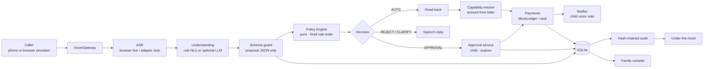

# Architecture

Provider-agnostic hexagonal core. The domain never imports a vendor SDK; every
external dependency is a port with a deterministic fake.



## Modules

| Path | Responsibility |
|---|---|
| `apps/api/munshi/policy.py` | Pure decision engine, fixed rule order, rule code returned |
| `apps/api/munshi/statemachine.py` | Explicit transaction transitions; terminal immutability |
| `apps/api/munshi/money.py` | Integer paise, Indian grouping, Hindi/English read-back |
| `apps/api/munshi/nlu.py` | Deterministic Hindi/Hinglish/English intent parsing |
| `apps/api/munshi/limits.py` | Voice-note onboarding parser and read-back |
| `apps/api/munshi/orchestrator.py` | Turn routing, read-back, approvals, pause, spend windows |
| `apps/api/munshi/db.py` | SQLite schema, seed, repositories, audit append/verify |
| `apps/api/munshi/capabilities/` | `pay_bill`, gas, medicine, message — plugin interface |
| `apps/api/munshi/adapters/` | Fakes (default) and explicit real-adapter stubs |
| `apps/api/munshi/service.py` | FastAPI routes, console auth, webhook signature |
| `packages/contracts/proposal.schema.json` | The only shape understanding may return |
| `apps/web/` | Call stage, Family console, Under the hood |

## Policy rule order (first match wins)

1. `P-CALLER-UNVERIFIED` → REJECT (no transaction created)
2. `P-SYSTEM-PAUSED` → REJECT
3. `P-DUPLICATE` → NO_OP (prior result)
4. `P-CAPABILITY-DISABLED` → REJECT
5. `P-AMOUNT-INVALID` → REJECT
6. `P-CONFIDENCE-LOW` → CLARIFY (up to max)
7. `P-CONFIDENCE-EXHAUSTED` → ESCALATE_TO_CHILD
8. `P-HARD-CEILING` → REJECT
9. `P-NEW-PAYEE` → REQUIRE_CHILD_APPROVAL
10. `P-PER-TXN-CAP` → REQUIRE_CHILD_APPROVAL
11. `P-DAILY-CAP` → REQUIRE_CHILD_APPROVAL
12. `P-MONTHLY-CAP` → REQUIRE_CHILD_APPROVAL
13. `P-OK` → AUTO_EXECUTE after spoken read-back

## Transaction state machine

```
PROPOSED -> REJECTED | NEEDS_CLARIFICATION | AWAITING_READBACK | AWAITING_APPROVAL | APPROVED
NEEDS_CLARIFICATION -> PROPOSED | CANCELLED
AWAITING_READBACK  -> APPROVED | CANCELLED | EXPIRED
AWAITING_APPROVAL  -> APPROVED | CANCELLED | EXPIRED
APPROVED -> EXECUTING
EXECUTING -> SUCCEEDED | FAILED
```

Terminal: REJECTED, SUCCEEDED, FAILED, CANCELLED, EXPIRED. Terminal is immutable.

## Amount integrity

1. Understanding never emits a money amount for a money capability.
2. `Capability.resolve()` fetches the amount (biller or synthetic catalog).
3. The amount is read back and confirmed.
4. Immediately before execution the amount is re-resolved. If it differs, the
   confirmation is voided, the old transaction is CANCELLED, and a new read-back
   starts. The same revalidation protects a delayed child approval.

## Idempotency

- Each transaction has a unique idempotency key; `MockLedger` dedupes by the
  execution key and is safe under concurrent duplicate calls.
- Payment webhooks are HMAC-verified and recorded by `event_id`; replay is a no-op.
- The policy duplicate rule is scoped to one call and a 60s window (see DECISIONS D-07).

## Audit chain

Each row hashes `seq | ts | actor | event | canonical(payload) | prev_hash`.
`verify_rows` returns the first bad sequence. This is tamper-evident, not a
blockchain, and the UI never calls it one.

## Spend windows

Daily and monthly spend is computed from SUCCEEDED transactions in the family’s
timezone (`Asia/Kolkata` by default), so month rollover is deterministic and testable
with an injected clock.

## Trust boundaries

- ASR text is untrusted; injection markers become `unclear`.
- Model output is schema-validated; unknown capabilities are discarded.
- Console actions resolve the family from the token; client-supplied family IDs are
  never trusted. Cross-family reads/decisions return 404.
- Spoken content on the parent call can never change limits.
